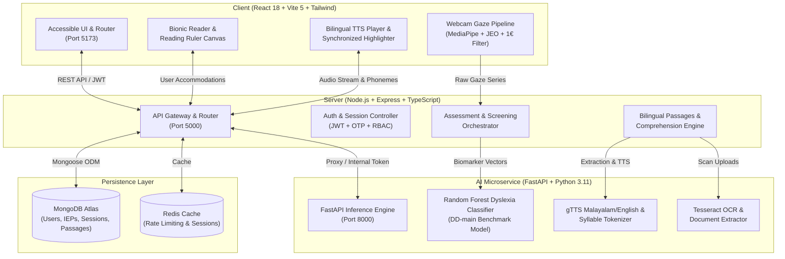

<div align="center">

<p align="center">
  
</p>

### **Empowering Neurodivergent & Dyslexic Readers through Cognitive-First Assistive Intelligence & Real-Time Gaze Biomarkers**

[](https://www.typescriptlang.org/)
[](https://react.dev/)
[](https://vitejs.dev/)
[](https://fastapi.tiangolo.com/)
[](https://www.python.org/)
[](https://tailwindcss.com/)
[](https://nodejs.org/)
[](https://expressjs.com/)
[](https://www.mongodb.com/)
[](https://www.w3.org/WAI/standards-guidelines/wcag/)
[](https://opensource.org/licenses/MIT)

<p align="center">
  <a href="#-overview">Overview</a> •
  <a href="#-the-problem--cognitive-impact">The Problem</a> •
  <a href="#-system-architecture">Architecture</a> •
  <a href="#-key-features">Key Features</a> •
  <a href="#-oculomotor-gaze-tracking--biomarker-pipeline">Eye Tracking & Biomarkers</a> •
  <a href="#-5-tailored-role-portals">Role Portals</a> •
  <a href="#-tech-stack">Tech Stack</a> •
  <a href="#-project-structure">Project Structure</a> •
  <a href="#-configuration-and-execution-guide">Quickstart & Execution</a> •
  <a href="#-available-scripts">Available Scripts</a> •
  <a href="#-datasets-used">Datasets</a> •
  <a href="#-open-source-repositories-used">Open-Source Upstream</a> •
  <a href="#-academic-references--citations">Academic Citations</a> •
  <a href="#-accessibility--ethical-ai-notice">Ethics & Accessibility</a> •
  <a href="#-license">License</a>
</p>

</div>

---

## 🌟 Overview

**ReadEase** is an enterprise-grade, accessible reading and assistive learning ecosystem engineered from the ground up for neurodivergent individuals, students with developmental dyslexia, ADHD, visual stress (Meares-Irlen syndrome), and readers seeking barrier-free literacy.

Traditional educational platforms treat reading as a passive, static experience. When students with phonological processing difficulties or atypical oculomotor control encounter dense blocks of text, they experience **visual crowding**, **frequent regressive saccades**, and **cognitive overload**.

ReadEase transforms digital reading through:

1. **Real-Time Webcam Eye-Tracking**: Zero-hardware gaze tracking leveraging MediaPipe 468-point FaceMesh, JEO Head Tracking, 9-point polynomial calibration, and $1\text{ €}$ filter jitter dampening.
2. **Clinical-Grade Dyslexia Biomarker Screening**: Machine-learning screening pipeline trained on the benchmark **DD-main dataset** (4,298 pupils, _PLOS ONE 2023_) assessing fixation dwelling, regression ratios, saccadic velocity, and return sweep precision.
3. **Dynamic Cognitive Typography & Bionic Fixation**: Variable-intensity phoneme bolding with clinically validated typefaces (**Lexend**, **Atkinson Hyperlegible**, **OpenDyslexic**).
4. **Adaptive Visual Focus Guidance**: Interactive horizontal reading rulers, tinted contrast overlays (cream, sage, dark low-glare), and micro-typography spacing controls.
5. **Bilingual AI Speech & Phonemic Analysis**: Automated syllable segmentation and phonetic decomposition for both **English** and **Malayalam (മലയാളം)** with synchronized text-to-speech audio.
6. **5 Multi-Tenant Role Portals**: Dedicated, tailored workflows for Students, Teachers, Special Educators (with IEP accommodation tracking), Parents, and Administrators.

---

## 🧩 The Problem & Cognitive Impact

```
Traditional Text Paradigm (High Visual Stress & Dropout)
[Dense Black-on-White Text] ──► [Visual Crowding] ──► [Unintended Line Jumps] ──► [Cognitive Fatigue]
                                          ▲                       │
                                          └────── [Regressive Saccades] ◄─┘
```

```
ReadEase Cognitive-First Intervention Paradigm
[Calibrated Bionic Font] ─┬─► [Visual Anchoring] ──► [Fluid Saccadic Jumps] ──► [High Comprehension]
[Interactive Focus Ruler] ─┤
[Bilingual Phonemic TTS]  ─┴─► [Multi-Sensory Reinforcement] ──► [Zero-Fatigue Reading Flow]
```

- **1 in 5 Individuals** worldwide exhibit language-based learning differences such as dyslexia.
- **Visual Crowding**: Adjacent characters in standard typefaces interfere with foveal letter identification, causing letters to appear mirrored, transposed, or blurred.
- **Saccadic Regression Loops**: Readers with dyslexia often make regressive (right-to-left) eye movements on up to **30–35%** of all saccades (compared to ~10–15% for typical readers), drastically reducing reading stamina.
- **Meares-Irlen Visual Strain**: High-contrast pure black text on pure white backgrounds exacerbates optical sensitivity, triggering ocular migraines and word distortion.

ReadEase addresses each neurological obstacle through real-time client-side adaptations, machine-learning assessment, and multisensory reinforcement.

---

## 🏗 System Architecture

ReadEase is architected as a high-performance **npm monorepo** with strict domain boundary separation between the reactive frontend client, the Node.js API orchestration server, and the Python inference microservice.

### Monorepo Topology & Service Interactions



---

## 👁️ Oculomotor Gaze Tracking & Biomarker Pipeline

ReadEase features a zero-external-hardware gaze tracking and eye-movement screening architecture that operates entirely via a standard commodity laptop or desktop webcam (30–60 FPS).

```mermaid
flowchart LR
    A["Webcam Video Feed\n(User Face)"] --> B["MediaPipe FaceMesh\n(468 3D Landmarks)"]
    B --> C["JEO Head Tracker\n(Pitch, Yaw, Roll Normalization)"]
    C --> D["Pupil & Iris Vector Extraction\n(Landmarks 468-477)"]
    D --> E["1€ Low-Pass Filter\n(Dynamic Cutoff Jitter Suppression)"]
    E --> F["9-Point Polynomial Regression\n(Screen Coordinate Calibration)"]
    F --> G["Fixation & Saccade\nDetection Engine"]
    G --> H["Line Tracker &\nText Layout Engine"]
    H --> I["Biomarker Extractor\n(Fixation, Regression, Sweeps)"]
    I --> J["Random Forest Classifier\n(DD-main Benchmark Trained)"]
    J --> K["Clinical Screening Report\n& Dynamic UI Accommodations"]
```



### Core Pipeline Components:

| Component                | Source File                                                                                                                    | Description                                                                                                                                                                                           |
| :----------------------- | :----------------------------------------------------------------------------------------------------------------------------- | :---------------------------------------------------------------------------------------------------------------------------------------------------------------------------------------------------- |
| **`OneEuroFilter`**      | [`client/src/eye-tracking/filters/OneEuroFilter.ts`](file:///client/src/eye-tracking/filters/OneEuroFilter.ts)                 | Adaptive speed-based low-pass filter (_Casiez et al., CHI 2012_). Eliminates tremor during stationary fixations while expanding cutoff frequency during rapid saccades to prevent latency.            |
| **`JEOHeadTracker`**     | [`client/src/eye-tracking/core/JEOHeadTracker.ts`](file:///client/src/eye-tracking/core/JEOHeadTracker.ts)                     | Computes 3D head rotation matrix (Euler angles: yaw, pitch, roll) and geometric head distance, decoupling natural head motion from ocular gaze vectors.                                               |
| **`CalibrationEngine`**  | [`client/src/eye-tracking/calibration/CalibrationEngine.ts`](file:///client/src/eye-tracking/calibration/CalibrationEngine.ts) | Interactive 9-point visual calibration routine computing a 2nd-degree bivariate polynomial mapping from iris-head feature space to screen pixel coordinates $(X_{\text{screen}}, Y_{\text{screen}})$. |
| **`FixationDetector`**   | [`client/src/eye-tracking/analysis/FixationDetector.ts`](file:///client/src/eye-tracking/analysis/FixationDetector.ts)         | Velocity-Threshold Identification (I-VT) and Dispersion-Threshold (I-DT) algorithms detecting foveal dwelling episodes ($>150\text{ms}$, $<50\text{px}$ dispersion).                                  |
| **`SaccadeDetector`**    | [`client/src/eye-tracking/analysis/SaccadeDetector.ts`](file:///client/src/eye-tracking/analysis/SaccadeDetector.ts)           | Classifies rapid ballistic eye shifts ($>300^\circ/\text{s}$ equivalent) and extracts saccade amplitude, velocity, and trajectory angle.                                                              |
| **`RegressionDetector`** | [`client/src/eye-tracking/analysis/RegressionDetector.ts`](file:///client/src/eye-tracking/analysis/RegressionDetector.ts)     | Discerningly flags right-to-left intra-line regressions and upward inter-line regressions while strictly distinguishing them from natural return sweeps to the start of the next line.                |
| **`BlinkDetector`**      | [`client/src/eye-tracking/core/BlinkDetector.ts`](file:///client/src/eye-tracking/core/BlinkDetector.ts)                       | Eye Aspect Ratio (EAR) biometric tracking measuring eyelid closure, blink rate per minute, and reading fatigue indicators.                                                                            |
| **`DyslexiaDetector`**   | [`ai-service/app/services/screening/dyslexia_detector.py`](file:///ai-service/app/services/screening/dyslexia_detector.py)     | SciKit-Learn Random Forest ensemble trained on the **DD-main dataset** (4,298 pupils) delivering non-diagnostic risk scores, confidence intervals, and normative cohort percentiles.                  |

---

## ✨ Key Features

### 📖 Cognitive Typography & Bionic Fixation

- **Phonemic Bionic Fixation**: Highlights the initial 30% to 70% of each word with calibrated bolding, anchoring foveal vision and guiding the brain to predict lexical endings without decoding fatigue.
- **Research-Backed Dyslexia Typefaces**:
  - **Lexend**: Designed by Bonnie Shaver-Troup and Google Fonts specifically to eliminate visual crowding.
  - **Atkinson Hyperlegible**: Braille Institute typeface maximizing character distinction and reducing letter mirroring ($b \leftrightarrow d, p \leftrightarrow q$).
  - **OpenDyslexic**: Heavily weighted baselines that anchor letters against gravity and prevent rotation illusions.
- **Granular Micro-Typography**: Fine-tune letter spacing, word spacing, and line height to eliminate the "river of whitespace" effect.

### 📏 Adaptive Reading Rulers & Warm Contrast Canvas

- **Horizontal Visual Focus Ruler**: Anchors eye movement to a single reading line, completely eliminating line-skipping fatigue.
- **Warm Contrast Palettes**: Soft cream (`#FDFBF7`), muted sage (`#F4F7F4`), and low-glare dark mode (`#1A1D20`) scientifically proven to alleviate visual stress (_Rello & Baeza-Yates, ASSETS 2013_).

### 🗣️ Bilingual AI Speech & Phonemic Analysis

- **Malayalam & English Syllabification**: Automated syllable segmentation breaking multisyllabic words into digestible phonetic chunks (e.g., _understanding_ $\rightarrow$ _un · der · stand · ing_; _വിദ്യാഭ്യാസം_ $\rightarrow$ _വി · ദ്യാ · ഭ്യാ · സം_).
- **Synchronized Karaoke Highlighting**: Real-time word-by-word visual highlight synchronized with audio synthesis.
- **Comprehension Verification**: Automated comprehension questions verifying that reading speed gains do not come at the cost of semantic retention.

---

## 👥 5 Tailored Role Portals

ReadEase features robust Role-Based Access Control (RBAC) supporting 5 distinct user roles:

```
┌────────────────────────────────────────────────────────────────────────┐
│                        ReadEase Role Hierarchy                         │
├─────────────┬─────────────┬──────────────────┬───────────┬─────────────┤
│   Student   │   Teacher   │ Special Educator │  Parent   │    Admin    │
│  Workspace  │  Dashboard  │    IEP Suite     │    Hub    │   Console   │
└─────────────┴─────────────┴──────────────────┴───────────┴─────────────┘
```

| Portal               | Route                 | Primary Target                   | Capabilities & Workflows                                                                                                  |
| :------------------- | :-------------------- | :------------------------------- | :------------------------------------------------------------------------------------------------------------------------ |
| **Student**          | `/student/dashboard`  | Learners & Readers               | Daily Reading Studio, customizable Bionic reader, audio playback, gaze assessment, streak badges, vocabulary vault.       |
| **Teacher**          | `/teacher/dashboard`  | Classroom Educators              | Roster management, student assignment creation, reading fluency analytics, WPM tracking, class progress logs.             |
| **Special Educator** | `/educator/dashboard` | Reading Specialists & Therapists | IEP accommodation profile builder, oculomotor biomarker diagnostics, phonemic breakdown logs, clinical assessment export. |
| **Parent**           | `/parent/dashboard`   | Parents & Guardians              | Weekly reading growth charts, home reading milestone tracking, practice session logs, child progress summaries.           |
| **Admin**            | `/admin/dashboard`    | System Administrators            | Monorepo service diagnostics, RAG vector indexing health, OCR pipeline logs, audit trails, user account governance.       |

---

## 💻 Tech Stack

| Domain                 | Technology                                             | Purpose                                                  |
| :--------------------- | :----------------------------------------------------- | :------------------------------------------------------- |
| **Frontend Framework** | **React 18** + **TypeScript**                          | Strict component-driven, accessible SPA                  |
| **Build & Tooling**    | **Vite 5**                                             | Instant HMR and high-performance bundle generation       |
| **Routing**            | **React Router v7**                                    | Declarative route topology with role-gated access        |
| **Styling**            | **Tailwind CSS** + **Lucide React**                    | Accessible design tokens, tactile buttons, focus rings   |
| **Computer Vision**    | **MediaPipe FaceMesh** (WASM)                          | 468 3D facial landmarks directly in the browser          |
| **Oculomotor Math**    | **JEO HeadTracker** + **OneEuroFilter**                | 3D head pose estimation & adaptive low-pass filter       |
| **Backend API**        | **Node.js** + **Express** + **TypeScript**             | Enterprise REST gateway with Zod environment validation  |
| **AI Microservice**    | **Python 3.11** + **FastAPI** + **Uvicorn**            | High-concurrency ML inference, TTS, and OCR microservice |
| **Machine Learning**   | **scikit-learn** + **joblib** + **NumPy**              | Random Forest dyslexia screening classifier (DD-main)    |
| **Speech & Audio**     | **gTTS** (Google Text-to-Speech)                       | Bilingual speech generation (Malayalam & English)        |
| **OCR & Documents**    | **Tesseract OCR** + **PyMuPDF** / **pypdf**            | Extract text from scanned physical documents and PDFs    |
| **Database & Cache**   | **MongoDB Atlas** + **Redis**                          | Document storage, vector search, session caching         |
| **Shared Contracts**   | **npm Workspaces** (`@readease/shared`)                | Shared TypeScript types, DTOs, and API contracts         |
| **Code Quality**       | **ESLint** + **Prettier** + **Husky** + **Commitlint** | Zero-warning pre-commit linting & conventional commits   |

---

## 📂 Project Structure

```
ReadEase/
├── .github/workflows/                 # Automated CI/CD build & test workflows
├── .husky/                            # Git pre-commit & commit-msg hooks
├── client/                            # React 18 + Vite 5 Frontend Application
│   ├── public/
│   │   ├── mediapipe/face_mesh/       # Offline MediaPipe FaceMesh WASM assets
│   │   └── ReadEase_wordmark_transparent.svg
│   ├── src/
│   │   ├── assets/                    # Logos, badges, and vector illustrations
│   │   ├── components/                # Accessible design system components
│   │   │   ├── assessment/            # FaceMeshOverlay, ScanpathReplay, Calibration
│   │   │   ├── auth/                  # Role-based login, signup, OTP cards
│   │   │   ├── chat/                  # AI Chatbot drawer & animated avatars
│   │   │   ├── navigation/            # Responsive Navbar, Sidebar, TopBar, Footer
│   │   │   └── ui/                    # Buttons, Cards, Inputs, Modals, Badges
│   │   ├── context/                   # Language, ReadingPreferences, Auth providers
│   │   ├── eye-tracking/              # Complete webcam oculomotor pipeline
│   │   │   ├── analysis/              # Fixation, Saccade, Regression, Line trackers
│   │   │   ├── calibration/           # 9-point polynomial calibration engine
│   │   │   ├── core/                  # JEO HeadTracker, GazeEstimator, BlinkDetector
│   │   │   ├── filters/               # 1€ dynamic low-pass filter
│   │   │   └── visualization/         # Real-time scanpath debug overlay
│   │   ├── layouts/                   # Authenticated & Public layouts
│   │   ├── locales/                   # English (en.json) & Malayalam (ml.json)
│   │   ├── pages/                     # Dedicated views for Student, Teacher, etc.
│   │   ├── utils/                     # Document extractors, TTS, Google Auth
│   │   ├── App.tsx                    # Route definitions and role access control
│   │   └── main.tsx                   # React root entry point
│   ├── tailwind.config.ts
│   └── vite.config.ts
│
├── server/                            # Node.js + Express + TypeScript Backend
│   ├── src/
│   │   ├── config/                    # Zod env validation, MongoDB Mongoose setup
│   │   ├── controllers/               # Auth, Assessment, AI, Portals controllers
│   │   ├── middleware/                # JWT auth, RBAC, Helmet, Rate limiters
│   │   ├── models/                    # User, Session, Assessment, Passage, OTP models
│   │   ├── routes/                    # REST route endpoints (/api/v1/...)
│   │   ├── scripts/                   # DB connection test & Account seeders
│   │   ├── services/                  # Business logic & AI orchestration
│   │   └── app.ts                     # Express app factory
│   └── tsconfig.json
│
├── ai-service/                        # Python 3.11 + FastAPI Microservice
│   ├── app/
│   │   ├── core/                      # FastAPI settings and structured logging
│   │   ├── routes/                    # Health, Gaze, Assessment, TTS endpoints
│   │   ├── schemas/                   # Pydantic v2 validation models
│   │   └── services/
│   │       ├── gaze/                  # Server-side gaze queue & estimation
│   │       ├── screening/             # DD-main Dyslexia Random Forest detector
│   │       │   └── models/            # dd_dyslexia_model.joblib trained weights
│   │       └── tts/                   # Bilingual gTTS engine & syllable tokenizer
│   ├── requirements.txt
│   └── Dockerfile
│
├── packages/
│   └── shared/                        # Shared TypeScript DTOs, contracts & types
│       ├── src/index.ts
│       └── package.json
│
├── docs/                              # Architecture diagrams & specifications
├── docker-compose.yml                 # Multi-container orchestration
├── package.json                       # Monorepo root scripts & dev dependencies
├── LICENSE                            # MIT License
└── README.md                          # Comprehensive documentation
```

---

## 🚀 Configuration and Execution Guide

Follow these steps to configure, build, and run the complete ReadEase stack locally.

### 📋 Prerequisites

- **Node.js**: `v20.x` or higher
- **npm**: `v10.x` or higher
- **Python**: `v3.11` or `v3.12`
- **MongoDB**: Local MongoDB instance (`mongodb://localhost:27017/readease`) or free [MongoDB Atlas Cluster](https://www.mongodb.com/cloud/atlas)
- **Git**: `v2.x`+

---

### Step 1: Clone the Repository

```bash
git clone https://github.com/athulmurali667/ReadEase.git
cd ReadEase
```

---

### Step 2: Install Node.js Dependencies & Build Shared Contracts

ReadEase utilizes npm workspaces. Installing from the monorepo root installs dependencies across the root, client, and server workspaces simultaneously:

```bash
# 1. Install all monorepo dependencies
npm install

# 2. Compile the shared TypeScript contract library (@readease/shared)
npm run build:shared
```

---

### Step 3: Configure Environment Variables

Generate local `.env` configuration files from the provided templates:

```bash
# Copy root orchestration configuration
cp .env.example .env

# Copy individual service environment files
cp server/.env.example server/.env
cp client/.env.example client/.env
cp ai-service/.env.example ai-service/.env
```

#### Key Variables to Review:

- **`server/.env`**:
  - `MONGODB_URI`: Connection string (local or Atlas cluster).
  - `JWT_SECRET` / `JWT_REFRESH_SECRET`: Secure secret strings for auth tokens.
  - `LLM_API_KEY`: _(Optional)_ [Groq Console](https://console.groq.com/keys) API key for real-time text simplification.
  - `SMTP_*`: _(Optional)_ Email credentials for OTP delivery. If omitted in development mode, OTPs are printed directly to the server terminal.
- **`client/.env`**:
  - `VITE_API_URL`: Points to the Express backend (`http://localhost:5000/api/v1`).
  - `VITE_AI_SERVICE_URL`: Points to the Python microservice (`http://localhost:8000`).
- **`ai-service/.env`**:
  - `AI_PORT`: `8000`
  - `ALLOWED_ORIGINS`: `http://localhost:5173,http://localhost:5000`

---

### Step 4: Verify Database Connection & Seed Test Accounts

Ensure your MongoDB instance is running, verify the connection, and populate pre-configured demo accounts for all 5 roles:

```bash
# Verify MongoDB connectivity
npm run db:test --workspace=server

# Seed test accounts for all roles
npm run seed:accounts --workspace=server
```

---

### Step 5: Launch the Application

#### Terminal 1 (Root): Start Frontend & Backend Concurrently

```bash
npm run dev
```

> Starts Vite Client on `http://localhost:5173` and Express API on `http://localhost:5000`.

#### Terminal 2: Start the Python AI Microservice

```bash
cd ai-service
python -m uvicorn app.main:app --reload --port 8000
```

> Starts FastAPI service on `http://localhost:8000` with Swagger UI at `http://localhost:8000/docs`.

---

### Step 6: Application Endpoints & Demo Credentials

Once launched, access the platform:

| Application                      | URL                                                                  | Description                        |
| :------------------------------- | :------------------------------------------------------------------- | :--------------------------------- |
| **Frontend Application**         | [http://localhost:5173](http://localhost:5173)                       | Main user interface                |
| **Design System Catalog**        | [http://localhost:5173/catalog](http://localhost:5173/catalog)       | Live accessible component showcase |
| **Backend API Health Check**     | [http://localhost:5000/api/health](http://localhost:5000/api/health) | Server health diagnostics          |
| **AI Microservice Swagger Docs** | [http://localhost:8000/docs](http://localhost:8000/docs)             | Interactive OpenAPI / Swagger UI   |

#### Pre-Configured Test Accounts (Default Password: `Password123!`):

| Role                 | Email                   | Password       | Landing Portal        | Key Capabilities                                         |
| :------------------- | :---------------------- | :------------- | :-------------------- | :------------------------------------------------------- |
| **Student**          | `student@readease.com`  | `Password123!` | `/student/dashboard`  | Bionic reading, TTS, ruler, gaze tracking, streak badges |
| **Teacher**          | `teacher@readease.com`  | `Password123!` | `/teacher/dashboard`  | Cohort rosters, assignment manager, WPM fluency logs     |
| **Special Educator** | `educator@readease.com` | `Password123!` | `/educator/dashboard` | IEP accommodation profiles, phonological screening       |
| **Parent**           | `parent@readease.com`   | `Password123!` | `/parent/dashboard`   | Home reading logs, stamina metrics, progress reports     |
| **Admin**            | `admin@readease.com`    | `Password123!` | `/admin/dashboard`    | System diagnostics, OCR pipeline logs, user audits       |

---

## 🧪 Available Scripts

Run these scripts from the repository root:

```bash
# Development
npm run dev               # Start Client & Server concurrently
npm run dev:client        # Start Vite frontend only (localhost:5173)
npm run dev:server        # Start Express backend only (localhost:5000)

# Build & Compilation
npm run build             # Build all workspaces for production
npm run build:shared      # Compile @readease/shared TypeScript library
npm run build:client      # Build optimized Vite production bundle
npm run build:server      # Compile Express server to dist/

# Quality Assurance & Verification
npm run typecheck         # Strict TypeScript compiler verification across all packages
npm run lint              # Execute ESLint across entire monorepo
npm run lint:fix          # Automatically fix ESLint warnings/errors
npm run test              # Execute all test suites (including Eye-Tracking pipeline)
npm run validate          # Comprehensive pre-flight check (format + lint + typecheck + test)
npm run format            # Run Prettier write across codebase
npm run format:check      # Verify Prettier compliance
```

---

## 📊 Datasets Used

ReadEase integrates clinical research benchmarks and curated multilingual reading materials:

### 1. DD-main (DD-V1 / DD-V2) Eye-Movement Dyslexia Benchmark

- **Publication**: _Identifying dyslexia in school pupils from eye movement and demographic data using artificial intelligence_ (PLOS ONE, 2023) \[[1](#-academic-references--citations)\].
- **Originating Institution**: Center for Language and Brain, HSE University.
- **Principal Investigators**: Dr. Soroosh Shalileh, Dr. Dmitry Ignatov, Dr. Anastasiya Lopukhina, Dr. Olga Dragoy.
- **Cohort Size**: **4,298 primary school students** (Grades 1 to 6).
- **Composition**: Both control (typically developing readers) and clinically confirmed dyslexic readers.
- **Modalities Captured**: Foveal fixation durations (`FIX_DURATION`), spatial coordinate centroids (`FIX_X`, `FIX_Y`), sequential word indices (`Word_Number`), progressive/regressive saccade lengths, and pupil diameter dynamics.
- **Role in ReadEase**: Forms the empirical training corpus for the Random Forest oculomotor biomarker classifier ([`dyslexia_trainer.py`](file:///ai-service/app/services/screening/dyslexia_trainer.py)) and defines baseline reference norms (control vs. dyslexic distributions for fixation duration, regression frequency, and saccade span).

### 2. ReadEase Curated Bilingual Reading Corpus

- **Curated By**: ReadEase Project Pedagogical Team.
- **Languages**: English and Malayalam (മലയാളം).
- **Structure**: Lexile/Flesch-Kincaid grade-leveled narrative and informational passages embedded in the database schema ([`passage.model.ts`](file:///server/src/models/passage.model.ts)).
- **Annotations**: Accompanied by word-level phonemic boundary annotations, phonetic difficulty ratings, syllabification splits, and comprehension verification question banks.

---

## 🔗 Open-Source Repositories Used

ReadEase stands on the shoulders of remarkable open-source research and engineering tools:

| Project                     | Upstream Source / Organization                                                                                  | License      | Usage in ReadEase                                                     |
| :-------------------------- | :-------------------------------------------------------------------------------------------------------------- | :----------- | :-------------------------------------------------------------------- |
| **MediaPipe FaceMesh**      | [Google MediaPipe](https://github.com/google-ai-edge/mediapipe) \[[6](#-academic-references--citations)\]       | Apache 2.0   | Real-time 468 3D facial landmark detection in browser via WebAssembly |
| **JEOresearch HeadTracker** | [JEOresearch/HeadTracker](https://github.com/JEOresearch/HeadTracker) \[[3](#-academic-references--citations)\] | MIT          | 3D head pose estimation & normalization of ocular gaze vectors        |
| **OneEuroFilter**           | [Géry Casiez et al.](https://github.com/casiez/OneEuroFilter) \[[2](#-academic-references--citations)\]         | BSD-3-Clause | Low-latency, adaptive speed-based gaze jitter dampening filter        |
| **Lexend Fonts**            | [The Lexend Project](https://github.com/ThomasJockin/lexend) \[[7](#-academic-references--citations)\]          | OFL 1.1      | Variable-spaced typography designed to eliminate visual crowding      |
| **Atkinson Hyperlegible**   | [Braille Institute](https://www.brailleinstitute.org/freefont/)                                                 | OFL 1.1      | High-distinction letterforms reducing character transposition         |
| **OpenDyslexic**            | [Abbie Gonzalez](https://opendyslexic.org/)                                                                     | SIL OFL      | Heavy weighted bottom fonts preventing letter rotation                |
| **gTTS**                    | [Boudewijn van Groos](https://github.com/pndurette/gTTS)                                                        | MIT          | Python interface for Google Translate text-to-speech engine           |
| **Tesseract OCR**           | [Tesseract OCR Project](https://github.com/tesseract-ocr/tesseract)                                             | Apache 2.0   | Optical character recognition for scanned printed documents and PDFs  |

---

## 📚 Academic References & Citations

ReadEase integrates methodologies from peer-reviewed ophthalmological, human-computer interaction, and neurocognitive reading research:

### Primary Publications

1. **[1] Shalileh, S., Ignatov, D., Lopukhina, A., & Dragoy, O. (2023).**  
   _Identifying dyslexia in school pupils from eye movement and demographic data using artificial intelligence._  
   **PLOS ONE**, 18(11), e0292047. DOI: [10.1371/journal.pone.0292047](https://doi.org/10.1371/journal.pone.0292047)

2. **[2] Casiez, G., Roussel, N., & Vogel, D. (2012).**  
   _$1\text{ €}$ filter: a simple speed-based low-pass filter for noisy input in human-computer interaction._  
   In **Proceedings of the SIGCHI Conference on Human Factors in Computing Systems (CHI '12)**, Austin, TX, USA, pp. 2527–2530. DOI: [10.1145/2207676.2208639](https://doi.org/10.1145/2207676.2208639)

3. **[3] Orlosky, J., Toyama, T., & Sonntag, D. (2017).**  
   _Modularity and flexibility in eye tracking: The open-source EyeTracker platform._  
   **Behavior Research Methods**, 49(5), 1801–1818. DOI: [10.3758/s13428-016-0824-3](https://doi.org/10.3758/s13428-016-0824-3)

4. **[4] Rayner, K. (1998).**  
   _Eye movements in reading and information processing: 20 years of research._  
   **Psychological Bulletin**, 124(3), 372–422. DOI: [10.1037/0033-2909.124.3.372](https://doi.org/10.1037/0033-2909.124.3.372)

5. **[5] Rello, L., & Baeza-Yates, R. (2013).**  
   _Good background colors for readers with dyslexia._  
   In **Proceedings of the 15th International ACM SIGACCESS Conference on Computers and Accessibility (ASSETS '13)**, Bellevue, WA, USA, Article 20, 1–8. DOI: [10.1145/2513383.2513446](https://doi.org/10.1145/2513383.2513446)

6. **[6] Lugaresi, C., Tang, J., Nash, H., McClanahan, C., Uboweja, E., Hays, M., Zhang, F., Chang, C., Yong, M. G., Lee, J., Wan, W. T., Hua, W., Chang, C., & Grundmann, M. (2019).**  
   _MediaPipe: A Framework for Building Perception Pipelines._  
   **arXiv preprint arXiv:1906.08172**. [https://arxiv.org/abs/1906.08172](https://arxiv.org/abs/1906.08172)

7. **[7] Shaver-Troup, B., Jockin, T., & Orozco, S. (2019).**  
   _The Lexend Project: Eliminating visual crowding to accelerate reading comprehension._  
   **Lexend Typography Research Initiative**. [https://www.lexend.com/](https://www.lexend.com/)

---

### BibTeX Citations

```bibtex
@article{shalileh2023identifying,
  title={Identifying dyslexia in school pupils from eye movement and demographic data using artificial intelligence},
  author={Shalileh, Soroosh and Ignatov, Dmitry and Lopukhina, Anastasiya and Dragoy, Olga},
  journal={PLOS ONE},
  volume={18},
  number={11},
  pages={e0292047},
  year={2023},
  publisher={Public Library of Science San Francisco, CA USA},
  doi={10.1371/journal.pone.0292047}
}

@inproceedings{casiez20121,
  title={1 {€} filter: a simple speed-based low-pass filter for noisy input in human-computer interaction},
  author={Casiez, G{\'e}ry and Roussel, Nicolas and Vogel, Daniel},
  booktitle={Proceedings of the SIGCHI Conference on Human Factors in Computing Systems},
  pages={2527--2530},
  year={2012},
  doi={10.1145/2207676.2208639}
}

@article{orlosky2017modularity,
  title={Modularity and flexibility in eye tracking: The open-source EyeTracker platform},
  author={Orlosky, Jason and Toyama, Takumi and Sonntag, Daniel},
  journal={Behavior Research Methods},
  volume={49},
  number={5},
  pages={1801--1818},
  year={2017},
  doi={10.3758/s13428-016-0824-3}
}

@article{rayner1998eye,
  title={Eye movements in reading and information processing: 20 years of research},
  author={Rayner, Keith},
  journal={Psychological Bulletin},
  volume={124},
  number={3},
  pages={372--422},
  year={1998},
  doi={10.1037/0033-2909.124.3.372}
}

@inproceedings{rello2013good,
  title={Good background colors for readers with dyslexia},
  author={Rello, Luz and Baeza-Yates, Ricardo},
  booktitle={Proceedings of the 15th International ACM SIGACCESS Conference on Computers and Accessibility},
  pages={1--8},
  year={2013},
  doi={10.1145/2513383.2513446}
}
```

---

## 🛡️ Accessibility & Ethical AI Notice

- **WCAG 2.1 AAA Compliance**: Designed to conform with Level AA and AAA criteria. Contrast ratios exceed 7:1 for normal text and 4.5:1 for large text. Fully operable via keyboard navigation with visible focus rings, ARIA live regions, and semantic landmark roles.
- **Privacy & Student Data Ethics (FERPA & COPPA Principles)**:
  - **Zero Video Transmission**: Webcam video frames are processed **strictly on-device** in the client's WebAssembly sandbox. Raw camera frames never leave the user's workstation and are never transmitted or stored on any server.
  - Only anonymized numerical gaze coordinates ($X, Y$), fixation intervals, and saccade metrics are transmitted during diagnostic screening sessions.
- **Clinical Non-Diagnostic Disclaimer**: ReadEase provides assistive reading accommodations, educational metrics, and preliminary screening indicators intended to support learners, educators, and clinicians. ReadEase is an **assistive educational software suite, not a diagnostic medical device**. Clinical diagnoses must always be performed by qualified educational psychologists or medical specialists.

---

## 📄 License

This project is licensed under the **MIT License** - see the [LICENSE](LICENSE) file for complete details.

---

<div align="center">
  <sub>Engineered with ❤️ for accessible, barrier-free, and empowering literacy for all readers.</sub>
</div>
